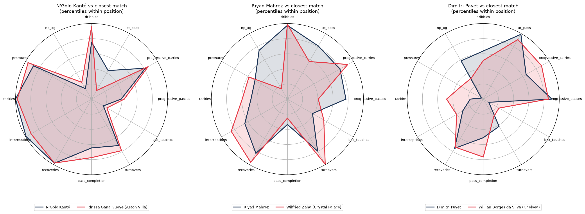
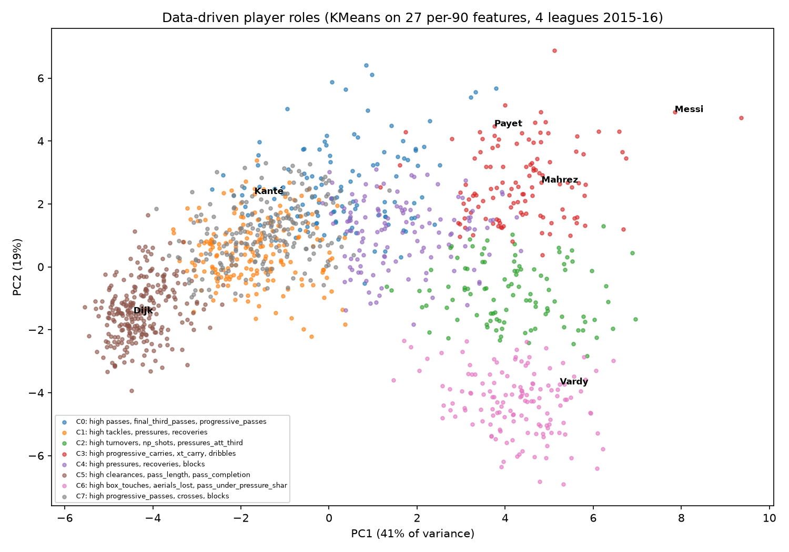
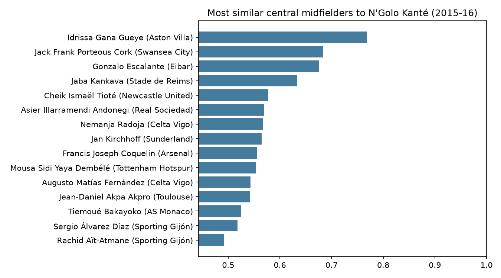

# Player replacement finder: similarity search and role clustering for recruitment

When a key player leaves, recruitment teams need to answer one question: **who plays like them, and who can we afford?**
This project builds per-90 style profiles for **1,264 outfield players** across four leagues from StatsBomb event data,
clusters them into data-driven roles, and ranks the most similar players to anyone you pick. It can also limit the search to
lower-placed clubs as a budget filter.

Author: Anthony Adusei-Poku ([@anthony07-max](https://github.com/anthony07-max))



## Key findings (2015-16 Premier League, La Liga, Serie A, Ligue 1; 900+ minutes)
1. **The closest match to N'Golo Kanté was Idrissa Gueye (similarity 0.77).** Kanté left Leicester for Chelsea in July 2016,
   and Gueye was at relegated Aston Villa, so the budget version of the search returns him too. Everton signed Gueye in August 2016.
   Next came Jack Cork (Swansea), Gonzalo Escalante (Eibar) and Jaba Kankava (Reims).
2. **The model disagreed with Leicester's real replacement.** Nampalys Mendy, whom Leicester signed from Nice, sits in the same
   ball-winning role cluster as Kanté. On the full profile, though, he ranks only **218th of 294** central midfielders by similarity.
   Mendy was a deeper, less mobile holder, which shows why a single "defensive midfielder" label isn't enough.
3. **For Riyad Mahrez:** the closest matches were Wilfried Zaha (0.69) and Sofiane Boufal (Lille, 0.69), with Carrasco and a
   teenage Ousmane Dembélé (Rennes) in the top five. **For Dimitri Payet:** Willian (0.79) and Di María (0.78) came first, with Papu Gómez (Atalanta) as the value pick.
4. **Roles:** KMeans on 27 features (8 PCA components, with 60% of the variance in the first two) separates ball-winners, progressive full-backs,
   carriers and dribblers, box strikers, pressing forwards and ball-playing centre-backs. Silhouette scores are modest (0.23 to 0.27),
   which is honest: player styles form a continuum, not neat boxes.

| | |
|---|---|
|  |  |

## About lower-league data
The aim was a League One focus. However, **there is no free, licence-compliant player event dataset for League One.**
FBref's terms restrict scraping, and its detailed Opta stats ended in 2025. Wyscout and Opta lower-league feeds are paid.
StatsBomb's open data covers top-flight competitions only, so this project uses those. **The method is league-agnostic.**
`src/similarity.py` works on any table of per-90 features, so a club with Wyscout or StatsBomb League One data could plug that in,
and the "finished at or below" filter mimics searching cheaper clubs.

## Method
- **Profiles:** 27 features per player. These include passes, completion and length, progressive passes and carries
  (moves that get at least 25% closer to goal), final-third and box passes, crosses, xT from passes and from carries (from a model fitted on the same data),
  dribbles, non-penalty shots and xG, box touches, pressures (overall and in the attacking third), tackles, interceptions, recoveries, clearances, blocks,
  aerials lost, fouls won, turnovers and average position. Counts are per 90, using minutes rebuilt from line-ups and substitutions.
- **Similarity:** features are z-scored within each position group and clipped at ±3, then compared with cosine similarity.
  The search excludes the player's own club. A filter on league position can be added.
- **Limitations:** this is one season of data from 2015-16, and there's no market value or wage data (league position is only a proxy).
  The stats aren't adjusted for possession. The minutes calculation ignores red cards.

## Data source
- [StatsBomb Open Data](https://github.com/statsbomb/open-data): 2015-16 Premier League, La Liga, Serie A and Ligue 1 events.
  Used under the [StatsBomb public data user agreement](https://github.com/statsbomb/open-data/blob/master/LICENSE.pdf). Data provided by **StatsBomb (Hudl)**.
  The open release has only 34 Bundesliga matches from 2015-16, so the Bundesliga is excluded.

## How to run
```bash
python -m venv .venv && source .venv/bin/activate
pip install -r requirements.txt
bash run_pipeline.sh      # downloads about 5 GB of event JSON (kept as compact parquet), then builds profiles
streamlit run app/streamlit_app.py
```
